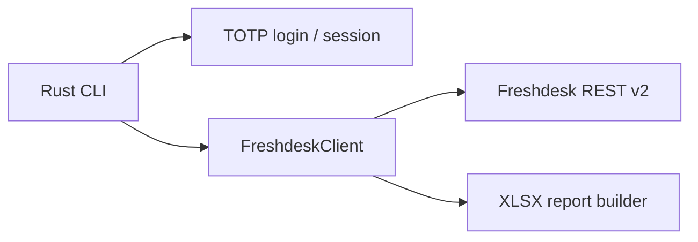

<div align="center">

# freshdesk

**Freshdesk API client and CLI in Rust — tickets, TOTP agent login, quarterly SLA reports.**

[](https://github.com/Delnegend/freshdesk/actions)
[](https://github.com/Delnegend/freshdesk/releases)
[](LICENSE)

</div>

---

## Quick Start

```bash
# 1. Point it at your account
cp .env.example .env   # then fill in FD_SERVER, FD_USER, FD_PASSWORD, FD_TOTP_SEED

# 2. Log in (solves the invisible challenge, stores a session cookie)
cargo run -- login

# 3. List your open tickets
cargo run -- list --filter new-and-my-open --per-page 10
```

## Highlights

- **Agent login without the browser dance** — credentials plus TOTP seed refresh the session automatically.
- **SLA fields computed for you** — TTR deadline, remaining time, and overdue flags on every ticket.
- **Quarterly reports as real spreadsheets** — per-product overdue counts with `IF`/`SUMIF` formulas and clickable in-charge checkboxes.
- **No tenant data baked in** — product catalog and checkboxes come from your `.env`, never the source.

## Common Options

```bash
cargo run -- list --properties --json
cargo run -- search --component <product> --properties --json
cargo run -- report 2026Q3 --output my_report.xlsx
```

| Option | Default | Description |
|---|---|---|
| `--properties` | off | Key fields only: TTR, overdue, components, created-at |
| `--json` | off | Raw JSON for `jq` (on list, search, get, me, components) |
| `--output <file>` | `<QUARTER>_report.xlsx` | Report path (report only) |

Flag details, auth methods, and the Excel layout: **[Configuration](docs/configuration.md)** and **[Commands](docs/commands.md)**.

## Architecture



Auth flow and client design: **[Architecture](docs/architecture.md)**. Library surface: **[API Reference](docs/api-reference.md)**.

## Documentation

- **[Commands](docs/commands.md)** — every subcommand and flag, verified against `--help`.
- **[Configuration](docs/configuration.md)** — `.env` keys, CLI flags, catalog sync script.
- **[Reports](docs/reports.md)** — quarterly Excel layout and formulas.
- **[Library](docs/library.md)** — using the crate from your own Rust code.
- **[Authentication](docs/authentication.md)** — login, API keys, session cookies.
- **[Development](docs/development.md)** — gates, tests, live-test setup.

## License

[MIT](LICENSE)
